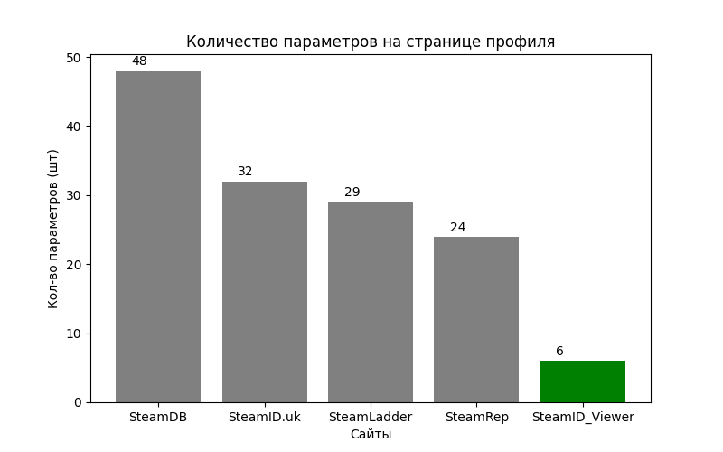
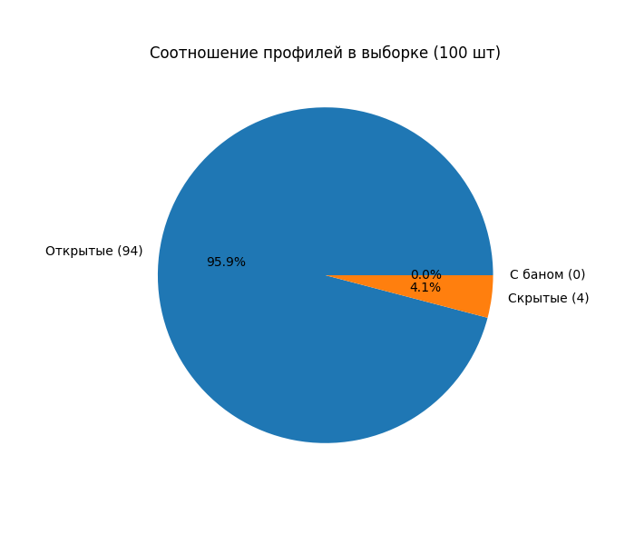
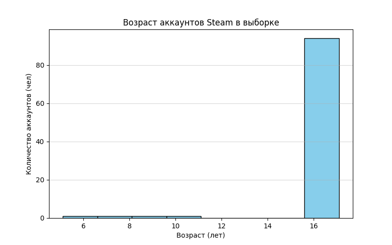
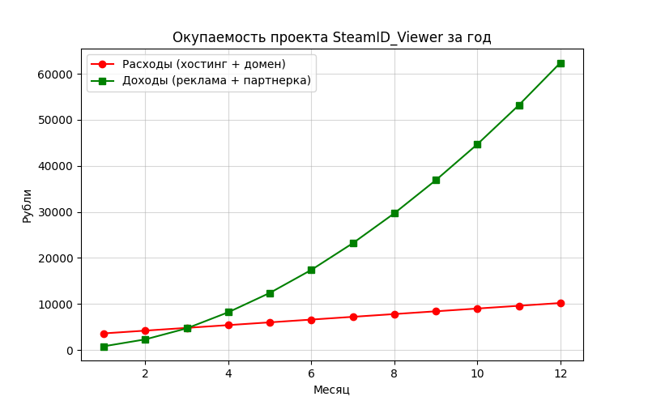

# SteamID_Viewer — Анализ данных и обоснование проекта

# 1. Какие данные брали
Для анализа собрали выборку из 100 реальных аккаунтов через официальный Steam Web API (файл `steam_profiles_sample.csv`), а также посмотрели общую статистику по игрокам в РФ:
* В России примерно 12–15 млн активных пользователей Steam.
* Основная аудитория игровых сайтов — парни 18–24 лет (студенты и школьники).
* Платить за данный сайт молодеж не будет т.к есть бесплатные конкуренты, а зарабатывать он будет за счет рекламных соглашений.

# 2. Проблема и социальная польза

# Переизбыток информации на других сайтах

На популярных сайтах вроде SteamDB или SteamID.uk на страницу вываливается от 24 до 48 технических пунктов (разные ID, хеши, история пакетов). Обычному игроку нужно всего 6 основных пунктов: ник, аватарка, дата создания аккаунта, часы, количество игр и наличие банов. В `SteamID_Viewer` оставляем только их.

# Проверка на баны и скрытые профили

По выборке видно, что 94 аккаунта открытые, 4 скрытые и нету ни одного забаненного (в итоге выходит 98 аккаунтов, предположительно 2 из недостающих были удалены), так же возрасть подавляющего большинства аккаунтов 16 лет, так получилось изза нашей выборки, где мы попали в эпоху таких игр как "CS 1.6", "Left 4 Dead" и еще несколько гигантов гейм индустрии.

# 3. Экономическая целесообразность

Расходы: сам Steam API бесплатный. Нужен только домен и стартовая настройка (~3000 руб.) + простой VPS-хостинг за 600 руб. в месяц.
Доходы: если привлечь хотя бы 15 000 человек в месяц (около 0.1% от игроков в РФ), то баннеры РСЯ и партнерские ссылки на сервисы пополнения баланса Steam будут приносить от 800 руб. в первый месяц до 9000 руб. к концу года.
Итог: на 4-й месяц работы доходы полностью перекрывают расходы на хостинг, и проект выходит в плюс.